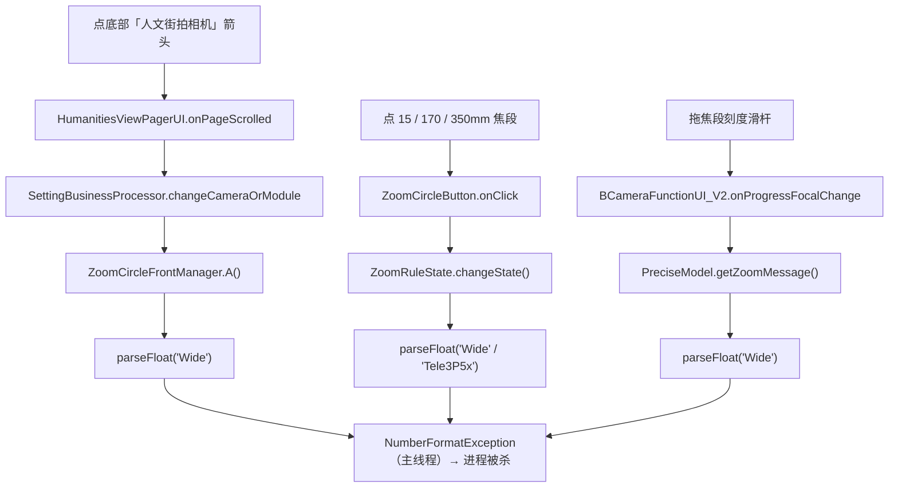

# 人文街拍闪退：一个把镜头标签当数字解析的移植包

机器是 vivo V2454A（PD2454），Android 17。装的是从 X200 移植过来的相机包
`dev.x200.vivomod` 16.1.4.183 —— 日常拍照、人像、夜景都正常，只有底部那个
「人文街拍相机」一点就退回桌面。

同一台机器、同一套相机 HAL，系统自带相机 13.0.55.13 进人文街拍完全没事，
所以排除了硬件、HAL 和机型伪装。

修完的状态：进得去，六个焦段随便点，下面那条刻度滑杆随便拖，拍照正常。
崩溃的根子是同一个 —— 移植包把镜头标签（`Wide`、`Tele3P5x`）写进了一个本该
存倍率数字的 `String` 字段，而代码里三处直接拿它喂 `Float.parseFloat`。
三处分散在三个类、两个 dex 里，所以修了三轮。

## 三条崩溃路径



三条路径最后都撞在同一件事上：`ZoomConfig$CameraTypeZoomPoint.zoom` 这个字段声明成
`String`，正常实现里它应该是 `"0.65"` / `"1.0"` / `"3.7"` 这样的数字串，移植包给
PD2454 补的那层反射适配（`dev.x200.vivomod.ZoomCompat`）把 `cameraType` 的标签串塞了
进去。于是所有"拿 zoom 直接 parseFloat"的调用点一起中招。

完整的 logcat 栈在 [docs/01-crash-traces.md](docs/01-crash-traces.md)。

## 结果

| 动作 | 改之前 | 现在 |
|---|---|---|
| 进人文街拍 | 必崩 | 正常 |
| 点 15 / 170 / 350mm | 必崩 | 正常 |
| 点 35 / 50 / 85mm | 本来就不崩 | 正常 |
| 拖刻度滑杆 | 崩（第三轮才发现） | 正常 |
| 人文模式拍照 | — | 正常出图 |
| 普通变焦 / 人像 / 风光 / 前后摄 / 杀进程重进 | — | 无异常 |

最后一轮验证后 `logcat` 里 `FATAL EXCEPTION`、`NumberFormatException`、`am_crash`
三个关键字计数都是 0。逐项回归表在 [docs/03-regression.md](docs/03-regression.md)。

## 为什么不去裁焦段表

第一反应是把移植包那 10 档焦段表砍到跟原机一样的 5 档，让 `350mm` 这类"多出来的"
档位干脆不存在。试了半轮就放弃了，两个原因：

一是治不了。最广那档不管叫 14mm 还是 15mm，`zoom` 字段照样是 `"Wide"`，进模式那一下
还是崩。真正要改的是"怎么读这个字段"，不是"有几档"。

二是会连坐。这张表来自 `getZoomConvenientOptions()`，被 Food、AGENT、HighResolution、
HUMANITIES 等十来个模块共用，动它等于给其它模式的变焦重新洗牌。

所以最后选择在三个读取点各加一层归一化，把 `Wide` / `SAT` 映射回 0.65、`Tele3P5x` /
`Tele` 映射回 3.7 —— 这些数字不是猜的，是从 `ZoomCompat.create()` 里真实的镜头配置抄的。

## 改包是怎么做的

`apktool 3.0.3` 反编译（2.9.3 解不开这个包的 `dex 040`），改 smali，用 smali 汇编器
单独重编改动的那一个 dex，再用 [tools/repack.py](tools/repack.py) 把基线 APK 的
16740 个条目原样搬到新包里、只替换这一个 dex，最后 `zipalign -p -f 4` + `apksigner`
（v1+v2+v3）。三轮都用同一个 keystore，所以全程 `adb install -r` 覆盖安装，
不卸载、不丢数据，也不用重新授权相机权限。

`apktool b` 全量回编译也试过，能出包，但所有 dex 会被降级成 039、所有条目退化成
stored，514 MB 变成 603 MB，没必要。细节和踩过的坑都在
[docs/02-repack-notes.md](docs/02-repack-notes.md)。

## 还没解决的

录像模式下点录制键会崩，跟这次修的三处无关：

```
java.lang.RuntimeException: Error! can not find any match zoom button. currentValue is 0.6
  at com.android.camera.ui.commonui.zoomui.widget.circlegroup.a.K(ZoomCircleGroupManager.java:388)
  at ba.w.x(StatePreviewing_VideoBase.java:74)
```

A/B 回滚到上一轮的包，跑同样的"进录像 → 点录制"，崩得一模一样，所以这是移植包
自带的缺陷，不是补丁带来的。这次没动它。

## 仓库里有什么

```
docs/01-crash-traces.md   三条崩溃的完整栈和读法
docs/02-repack-notes.md   apktool 版本、dex 版本、对齐签名，还有几个环境上的坑
docs/03-regression.md     回归清单、判定标准、回滚方法
patches/                  三份 smali diff
tools/repack.py           按条目替换 APK 内容，其余原样搬
tools/dexcheck.py         校验 dex 版本、adler32、sha1，以及补丁方法有没有进去
```

仓库里没有 APK（单文件 514 MB，超 GitHub 上限，原厂包也有版权），没有签名证书和
密码，没有应用私有数据，也没有设备截图和序列号。

补丁是按 `16.1.4.183` 这个特定版本的偏移量做的，换个版本地址就变，不能直接套。
纯粹是个人设备上的排障记录。
